# Asistente Académico · Ingeniería de Sistemas (UNAB)

Chatbot de apoyo académico para estudiantes de Ingeniería de Sistemas. El estudiante escribe su código estudiantil en el chat y el asistente le
responde con su matrícula, su avance en el plan de estudios, su promedio, qué materias cursar, las fechas del calendario, las noticias de la
universidad y las normas del programa (con cita del documento). Combina **RAG** sobre documentos institucionales con **agentes que consultan
herramientas MCP**, y todo corre sobre servicios gratuitos o de estudiante.

> **Los datos son de demostración.** Los 30 estudiantes, sus notas, el calendario y los 7 documentos institucionales son ficticios: no hay conexión
> con Banner ni con ningún sistema real de la universidad.

**Demo en producción:** <https://chatbot.javier.life> · códigos de prueba: `U00100001` a `U00100030` · **[Manual de usuario](docs/manual-de-usuario.md)** · **[Prompts y fundamento pedagógico](docs/prompts-y-pedagogia.md)**

## Contenido

[Video](#video) · [Capturas](#capturas) · [Qué hace](#qué-hace) · [App móvil](#app-móvil-expo-go) · [Requisitos](#requisitos-del-proyecto-y-dónde-se-cumplen) · [Arquitectura](#arquitectura) · [Flujos en n8n](#flujos-en-n8n) · [RAG](#rag-pipeline-parámetros-y-evaluación) · [Herramientas del MCP](#herramientas-del-mcp) ·
[Datos de demostración](#datos-de-demostración) · [Estructura](#estructura-del-repositorio) · [Instalación](#instalación-y-despliegue) ·
[Configuración](#configuración) · [Pruebas](#pruebas) · [Evidencias](#evidencias) · [Identidad](#cómo-funciona-la-identidad) · [Seguridad](#seguridad) · [Decisiones y límites](#decisiones-de-diseño-y-límites) · [Hoja de ruta](#hoja-de-ruta)

## Video

Recorrido de 2:39 minutos, con subtítulos, por el proyecto funcionando en producción: qué problema resuelve, la identificación con el código
estudiantil, varias consultas reales (avance, calculadora de notas, calendario, requisitos de grado con cita del documento), cómo funciona por dentro
y sus límites.

<p align="center">
  <a href="docs/asistente_academico.mp4">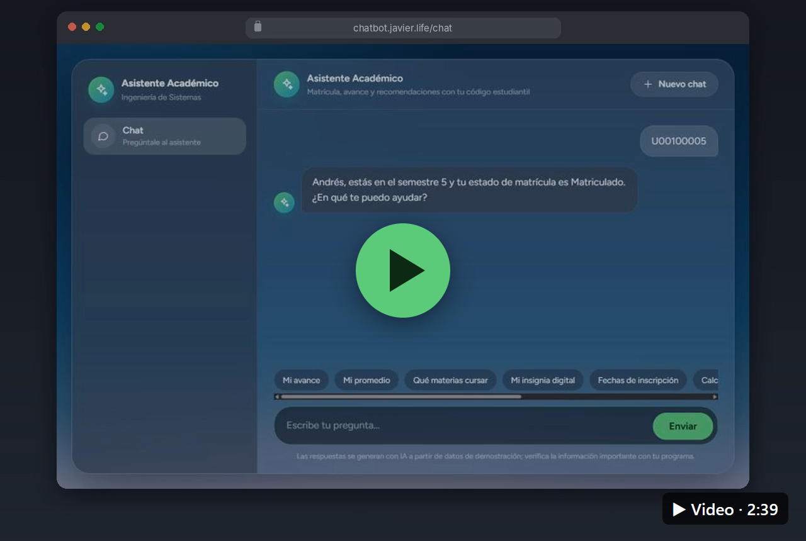</a><br>
  <em>Haz clic en la imagen para abrir el video (<code>docs/asistente_academico.mp4</code>, 4,8 MB). Si GitHub no lo reproduce en la página,
  usa <strong>View raw</strong> o descárgalo.</em>
</p>

| Minuto (aprox.) | Contenido |
|---|---|
| 0:00 | Las preguntas que resuelve el asistente |
| 0:24 | Pantalla de bienvenida y datos de demostración |
| 0:48 | Identificación con el código `U00100005` |
| 1:12 | Calculadora de notas (3.5 y 2.8 en los dos primeros cortes) |
| 1:36 | Calendario y requisitos de grado, citando el documento de origen |
| 2:00 | Cómo funciona: web y app, n8n, agentes, RAG, filtros de seguridad |
| 2:23 | Lo que hay que saber: datos ficticios, el código como única credencial y el efecto de escritura |

## Capturas

Capturas reales del sitio en producción, con estudiantes sintéticos.

<p align="center">
  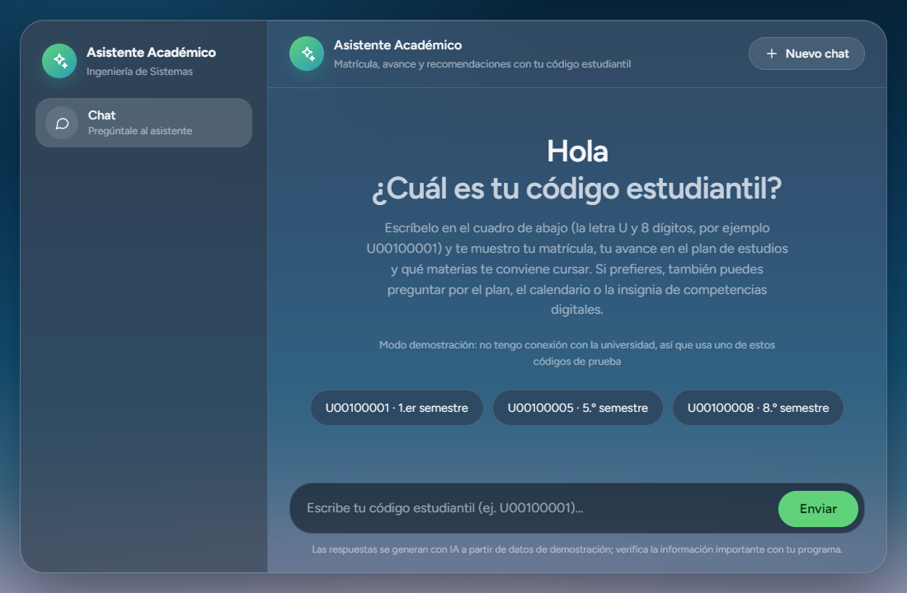<br>
  <em><strong>Bienvenida.</strong> Pide el código estudiantil y ofrece códigos de prueba.</em>
</p>

<p align="center">
  <br>
  <em><strong>Identificación.</strong> El asistente reconoce al estudiante por su código y aparece la barra de preguntas sugeridas.</em>
</p>

## Qué hace

- **Identificación sin cuentas:** el estudiante escribe su código (`U` + 8 dígitos) y el asistente lo valida contra la base de datos.
- **Su información académica:** estado de matrícula, avance y proyección de semestres, materias recomendadas, cursos de la insignia de competencias
  digitales, promedio acumulado, carga máxima de créditos y becas, y la nota de cada materia aprobada.
- **Calculadora de notas:** con los cortes que ya tiene (30 % + 30 % + 40 %), dice qué necesita en lo que falta para llegar a 3.0.
- **Información institucional con RAG:** reglamento, matrícula, plan de estudios, grado y práctica, bienestar, homologaciones e insignia. Cada
  respuesta nombra el documento del que sale.
- **Calendario y noticias:** fechas del calendario académico y noticias de la universidad, actualizadas cada 6 horas y clasificadas por tema
  (ingeniería de sistemas, tecnología, educación u otros), siempre con su fecha y su fuente.
- **Preguntas sugeridas** y respuesta con efecto de escritura en la web.
- **Prompts documentados:** los prompts de los agentes y del clasificador, por qué están redactados así y su fundamento pedagógico con referencias, en [`docs/prompts-y-pedagogia.md`](docs/prompts-y-pedagogia.md).
- **Seguridad y control del alcance:** *guardrails* de entrada y salida, ruteo por intención y rechazo de temas ajenos a lo académico.

## Requisitos del proyecto y dónde se cumplen

| Requisito (diapositivas) | Dónde se cumple |
|---|---|
| Estado de matrícula, avance, proyección y recomendaciones | Herramientas `consultar_estudiante`, `avance_y_proyeccion`, `cursos_recomendados` y `plan_de_estudios` de `servidor-mcp/servidor_mcp.py`, más las vistas de `base-de-datos/esquema.sql` |
| Historial personalizado (cursos de competencias digitales, base sintética) | `competencias_digitales` y las tablas `curso_cd` y `cd_cursado` |
| Promedio, notas y situación académica | `promedio_y_estado`, `calcular_nota` y la columna `materia_aprobada.nota` |
| Insignia de competencias digitales y RAG institucional (CCD) | Flujo *Ingesta de documentos* + nodo PGVector del agente institucional; documentos en `documentos-rag/` |
| Calendario académico (Google Sheets) | `calendario_academico` lee el Sheet publicado como CSV si `CALENDARIO_CSV_URL` está definida; si no, la tabla `calendario` |
| Noticias (scraping periódico) | Flujo *Noticias UNAB*: API pública de unab.edu.co → tabla `noticia`, cada 6 horas, con el tema calculado al guardar (función `clasificar_tema`); `noticias_recientes` filtra por tema y devuelve fecha y fuente |
| Guardrails | Nodos *Guardrails* de n8n: jailbreak y claves secretas a la entrada; tarjetas, IBAN, cripto y claves a la salida |
| Memoria persistente | *Postgres Chat Memory* en Supabase, una por conversación (id de sesión que genera la web) |
| Ruteo por intención | *Text Classifier* de n8n → agente académico, agente institucional o respuesta de fuera de tema |
| Cliente MCP | Agente de n8n con Groq conectado al servidor MCP por HTTP, con token Bearer |
| Docker | `docker-compose.yml` y `servidor-mcp/Dockerfile` para correr el MCP (alternativa al instalador; no probada en este entorno) |

## Arquitectura

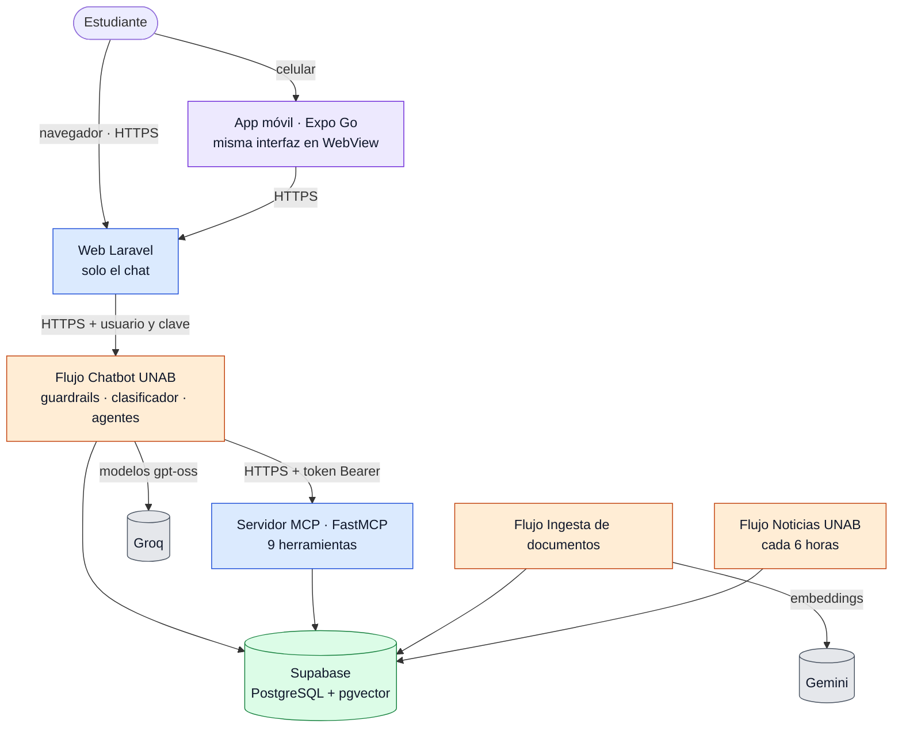

<sub>Azul: VM Debian en Azure, publicada con Cloudflare Tunnel y sin puertos abiertos · Naranja: n8n Cloud · Verde: base de datos · Gris: modelos externos · Morado: app móvil.</sub>

### Recorrido de una pregunta dentro de n8n

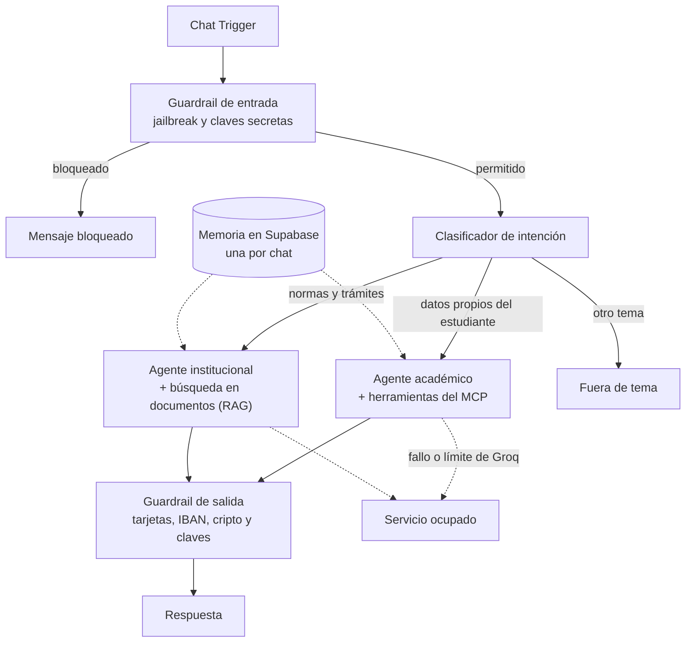

| Pieza | Tecnología | Función |
|---|---|---|
| App móvil | Expo SDK 58 (React Native) con `react-native-webview` | La misma interfaz de la web dentro de una app que se abre con Expo Go. Sin lógica propia: los cambios de la web aparecen en la app sin recompilar. |
| Web | Laravel 13 (PHP 8.4) | Solo el chat: sin cuentas ni base de datos. Reenvía a n8n con usuario y clave, que el navegador nunca ve. |
| Orquestación | n8n Cloud | Guardrails, clasificador, dos agentes, memoria de conversación y los flujos de ingesta y noticias. |
| Modelos | Groq: `gpt-oss-20b` (agentes) y `gpt-oss-120b` (filtros) | Razonamiento y llamadas a herramientas. |
| Herramientas | FastMCP 4 (Python) | Servidor MCP con 9 herramientas y token Bearer. |
| Datos y RAG | Supabase (PostgreSQL + pgvector) | Datos académicos sintéticos, memoria del chat y vectores de los documentos. |
| Embeddings | Gemini (`gemini-embedding-001`) | Vectores de 3072 dimensiones para el RAG. |
| Red | Cloudflare Tunnel | Publica la web y el MCP con HTTPS sin abrir puertos en Azure. |

## App móvil (Expo Go)

La carpeta [`app-movil/`](app-movil/) es una app de Expo (SDK 58) que muestra el chat de la web dentro de un WebView. Así la app queda conectada
al mismo webhook y con la misma interfaz, guardrails y límites que la web, que es el producto principal. Además añade:

- barra de estado y fondo con los colores del sitio, e icono generado a partir del de la web;
- indicador de carga y pantalla de «Sin conexión» con botón *Reintentar*;
- botón *Atrás* de Android dentro del chat;
- enlaces externos (por ejemplo, una noticia) que se abren en el navegador del teléfono, no dentro de la app.

Capturas de la app abierta con Expo Go en un teléfono:

<p align="center">
  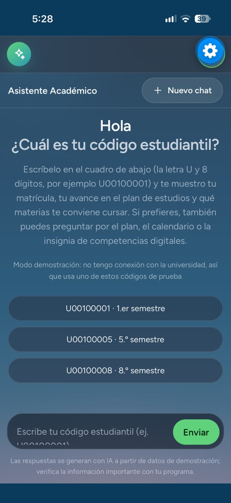
  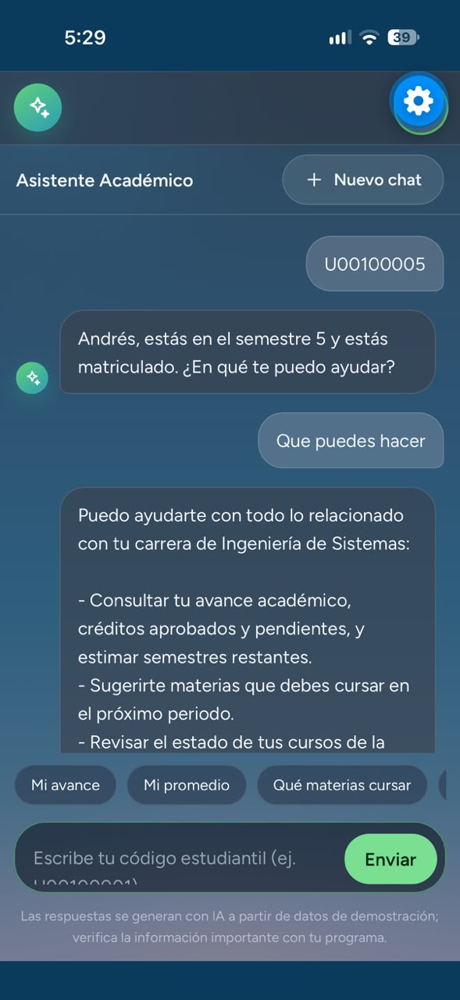
  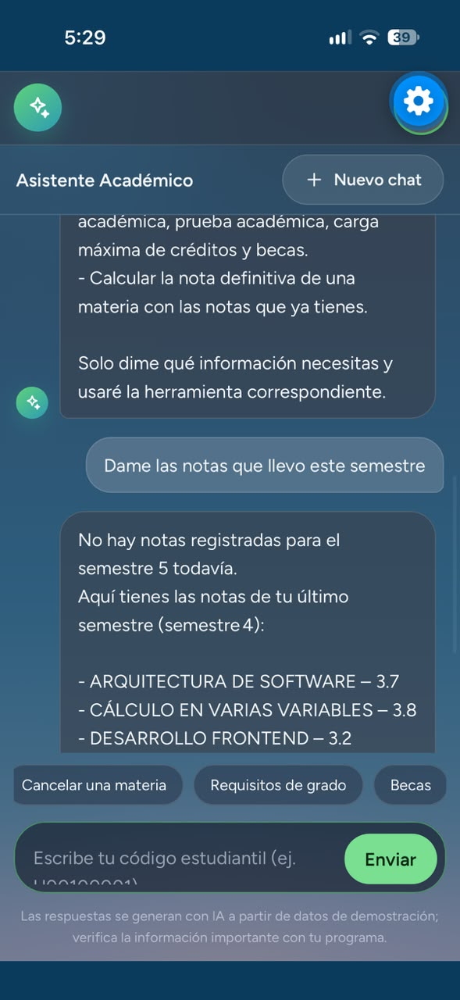<br>
  <em>Bienvenida · identificación con <code>U00100005</code> · notas del último semestre (coinciden con la base de datos).</em>
</p>

**Probarla en el teléfono** (Android o iPhone):

1. Instala **Expo Go** desde Google Play o la App Store.
2. En el computador, con el teléfono en la misma red Wi-Fi: `cd app-movil && npm install && npx expo start`.
3. Escanea el código QR que aparece en la terminal: con Expo Go en Android, o con la cámara en iPhone. También puedes escribir la dirección
   `exp://<IP-del-computador>:8081` en Expo Go.

Si el teléfono no está en la misma red, usa `npx expo start --tunnel`. Para verificar la configuración: `npx expo-doctor` (20 de 20 comprobaciones).


## Flujos en n8n

Los flujos están en [`flujos-n8n/flujos/`](flujos-n8n/flujos/) y se importan en n8n Cloud. Las imágenes son el lienzo de n8n dibujado con su componente
oficial a partir de esos archivos (no una captura de la cuenta de n8n Cloud, que exige iniciar sesión); se regeneran con `node pruebas/capturar_flujos_n8n.js`.

**Chatbot UNAB** (17 nodos): guardrails, clasificador de intención, agente académico con las herramientas del MCP, agente institucional con RAG, memoria y respuestas de error.

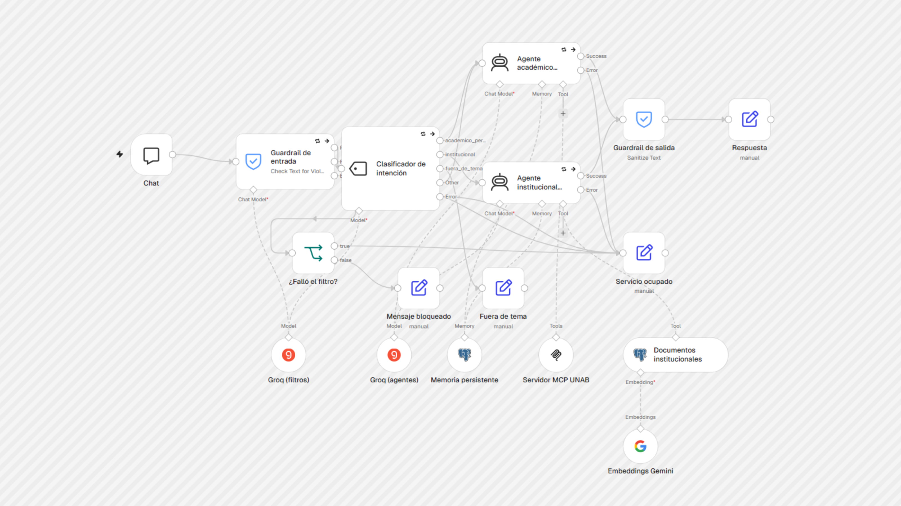

**Ingesta de documentos** (6 nodos): un formulario recibe los archivos, los separa, los fragmenta, calcula los embeddings con Gemini y los guarda en pgvector con el nombre del documento.

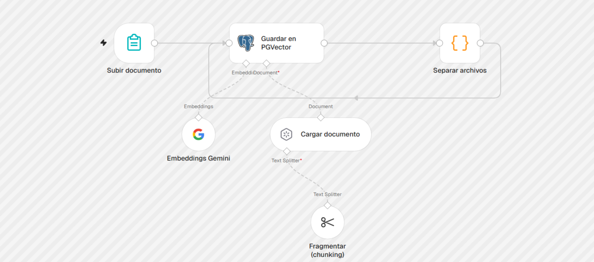

**Noticias UNAB** (4 nodos): cada 6 horas (o con el botón «Ejecutar ahora») lee las últimas 20 noticias de unab.edu.co y las guarda en la tabla `noticia`
clasificadas por tema según su título (ingeniería de sistemas, tecnología, educación u otros).

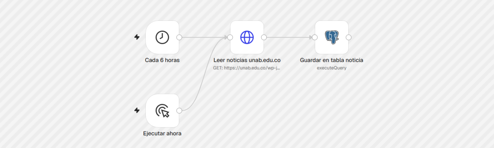

**Evaluación RAG** (10 nodos, herramienta de medición): dos webhooks con la misma clave básica que la web. Uno fragmenta un documento con el tamaño y el
solapamiento pedidos y lo guarda en una tabla de prueba; el otro devuelve el top-k de una consulta. Lo usa `pruebas/evaluar_rag.py` (ver la sección RAG).

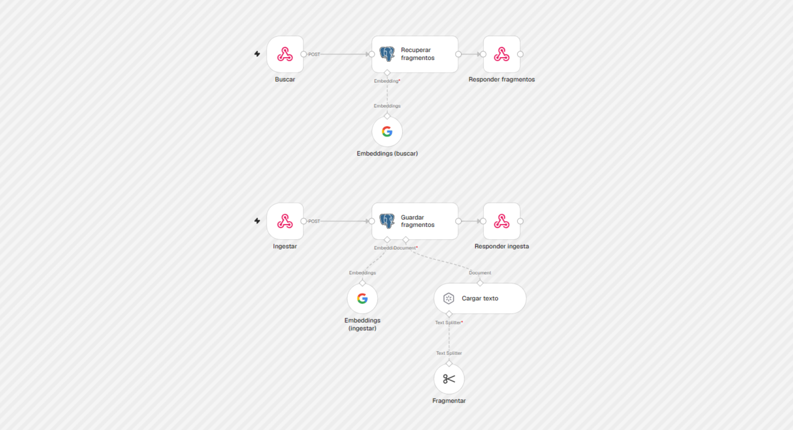

## RAG: pipeline, parámetros y evaluación

**Pipeline.** *Ingesta* (flujo *Ingesta de documentos*): formulario → un ítem por archivo → cargador de texto que añade el metadato `documento` →
divisor recursivo de caracteres (1000 / 150) → embeddings `gemini-embedding-001` (3072 dimensiones) → tabla `n8n_vectors` en pgvector.
*Consulta* (agente institucional): el agente reformula la pregunta como búsqueda → embedding con el mismo modelo → los 5 fragmentos más cercanos por
distancia coseno → respuesta que cita el documento de cada fragmento.

**Documentos** (ficticios, en `documentos-rag/`):

| Documento | Caracteres | Fragmentos | Qué responde |
|---|---|---|---|
| Reglamento estudiantil (resumen) | 2 674 | 4 | Escala de notas, asistencia, prueba académica, repetición de materias, carga de créditos |
| Proceso de inscripción y matrícula | 2 575 | 4 | Estados de matrícula, pasos del semestre, adición y cancelación, aplazamiento |
| Plan de estudios de Ingeniería de Sistemas | 3 903 | 5 | Duración, créditos, ciclos de formación, cursos menor, prerrequisitos |
| Homologaciones, reintegros y traslados | 2 436 | 3 | Homologación, reintegro, traslado interno, doble programa, intercambios |
| Bienestar, becas y apoyos | 2 367 | 3 | Monitorías, tutorías, becas, salud mental, accesibilidad |
| Requisitos de grado y práctica profesional | 2 157 | 3 | Requisitos para graduarse, práctica profesional, ceremonia de grado |
| Insignia de competencias digitales | 1 718 | 2 | Cursos CD01 a CD04, cómo se obtiene, qué pasa si se reprueba |

**Evaluación.** [`pruebas/evaluar_rag.py`](pruebas/evaluar_rag.py) mide la recuperación con 24 preguntas cuyo documento correcto se conoce
(3 por documento, redactadas con otras palabras, y 3 en inglés), probando varias configuraciones con el mismo modelo de embeddings. No gasta cupo de
Groq. Resultados completos y detalle por pregunta en [`docs/evaluacion-rag.md`](docs/evaluacion-rag.md):

| Tamaño / solapamiento | Fragmentos | Acierto en el 1.er puesto (Hit@1) | Hit@3 | MRR | Precisión@5 (techo) |
|---|---|---|---|---|---|
| 500 / 75 | 53 | 92 % | 100 % | 0.96 | 65 % (100 %) |
| **1000 / 150 (configuración de producción)** | **26** | **100 %** | **100 %** | **1.00** | **52 % (71 %)** |
| 2000 / 300 | 14 | 88 % | 100 % | 0.93 | 38 % (42 %) |
| Tabla real de producción (`n8n_vectors`) | 24 | 96 % | 100 % | 0.98 | 53 % (71 %) |

En la tabla real una pregunta («¿A cuántas horas de trabajo equivale un crédito?») queda en el 2.º puesto en lugar del 1.º; con top 5 el agente
la recibe igual.

**Justificación de los parámetros**, con lo medido:

| Parámetro | Valor | Por qué |
|---|---|---|
| Tamaño de fragmento | 1000 caracteres | Es el único que pone el documento correcto en el **primer puesto en las 24 preguntas** (Hit@1 100 %, MRR 1.00). El largo medio resultante (684 caracteres) coincide con una sección de los documentos, así que cada fragmento es una norma completa con su título. Con 500 las listas se separan de su encabezado y 2 preguntas pierden el primer puesto; con 2000 se mezclan secciones distintas en un mismo fragmento y pierden 3, además de enviar al modelo fragmentos el doble de largos. |
| Solapamiento | 150 caracteres | Medido: **no cambia nada en estos documentos** (1000/0 y 1000/150 dan resultados idénticos, y dos fragmentos seguidos comparten 0 caracteres). El divisor recursivo corta por párrafos y solo arrastra párrafos completos que quepan en el solapamiento, y aquí todos son más largos. Se mantiene como red de seguridad para documentos con párrafos de más de 1000 caracteres, donde sí actúa; con 400 dos fragmentos ya comparten 281 caracteres. |
| Fragmentos recuperados (top-k) | 5 | Con 3 ya se acierta siempre (Hit@3 100 %), pero 5 cubre los 2 a 4 fragmentos de un documento completo y deja margen para preguntas que cruzan dos documentos (por ejemplo, insignia y práctica profesional). Cuesta unos 900 tokens por búsqueda; si el cupo de Groq aprieta, se puede bajar a 3 sin perder aciertos en esta evaluación. |
| Modelo de embeddings | `gemini-embedding-001` (3072 dim.) | Multilingüe: las 3 preguntas en inglés encontraron el documento en español en el primer puesto. Gratuito en Google AI Studio y el mismo para ingestar y consultar (obligatorio: no se pueden mezclar modelos en una tabla). |
| Distancia | Coseno | La que usa pgvector por defecto con este nodo. En la prueba, una pregunta pertinente queda a unos 0.26 del mejor fragmento y una sin relación («receta de arepas») a 0.46, así que un umbral cercano a 0.4 permitiría detectar preguntas que los documentos no responden. |

## Herramientas del MCP

El agente académico elige entre estas herramientas del servidor [`servidor-mcp/servidor_mcp.py`](servidor-mcp/servidor_mcp.py):

| Herramienta | Qué devuelve |
|---|---|
| `consultar_estudiante` | Nombre, carrera, semestre actual y estado de matrícula; valida el código. |
| `avance_y_proyeccion` | Créditos aprobados y pendientes, porcentaje de avance y semestres restantes: el mayor entre lo que exige la carga de créditos y la cadena de prerrequisitos pendiente. |
| `cursos_recomendados` | Materias que ya puede inscribir (prerrequisitos cumplidos), sin pasar de la carga máxima, y las bloqueadas con lo que les falta. |
| `competencias_digitales` | Estado de los cursos CD01 a CD04 de la insignia y si ya la obtuvo. |
| `promedio_y_estado` | Promedio acumulado ponderado por créditos, estado frente al reglamento, carga máxima, beca y puesto en el programa; con `con_detalle=true`, la nota de cada materia. |
| `calcular_nota` | Nota definitiva o nota necesaria en lo que falta (cortes de 30 %, 30 % y 40 %; aprueba con 3.0). Usa `Decimal`, sin errores de coma flotante. |
| `plan_de_estudios` | Materias, créditos y prerrequisitos del plan, completo o de un semestre. |
| `calendario_academico` | Fechas del calendario; búsqueda tolerante a tildes y a la forma de la palabra. |
| `noticias_recientes` | Últimas noticias con fecha y fuente (enlace); filtro opcional por tema: ingeniería de sistemas, tecnología, educación u otros. |

## Datos de demostración

| Dato | Detalle |
|---|---|
| Estudiantes | 30, de `U00100001` a `U00100030`, repartidos en ciclo del 1.º al 8.º semestre. Los de 1.er semestre aún no tienen notas. |
| Plan de estudios | Ingeniería de Sistemas: 8 semestres, 134 créditos, 47 materias (`base-de-datos/planes_pregrados.csv`). |
| Prerrequisitos | 35, de demostración pero coherentes con el plan (`base-de-datos/prerrequisitos.csv`): siempre de un semestre anterior; la cadena más larga tiene 7 materias. Ningún estudiante tiene aprobada una materia sin su prerrequisito. |
| Notas | 616 notas de materias aprobadas, de 3.0 a 5.0 (media 3.94). No hay materias reprobadas ni del semestre en curso. |
| Calendario | 30 eventos de los periodos 2026-2 y 2027-1 (`base-de-datos/calendario_ejemplo.csv`). |
| Documentos del RAG | 7 documentos ficticios en `documentos-rag/` (24 fragmentos). |
| Noticias | Reales: se leen de la API pública de unab.edu.co. |

Códigos útiles para probar:

| Código | Promedio | Qué muestra |
|---|---|---|
| `U00100018` | 4.68 (puesto 1 de 26) | Puede inscribir 21 créditos y cumple el promedio de beca. |
| `U00100005` | 3.73 | Caso intermedio: avance del 48.5 %, 18 créditos máximos y materias bloqueadas por prerrequisitos. |
| `U00100004` | 3.38 (puesto 26) | El promedio más bajo. |
| `U00100001` | sin notas | Primer semestre. |

## Estructura del repositorio

```
.
├── sitio-web/            Web Laravel 13: solo el chat (controlador, vistas, CSS/JS y tests)
├── app-movil/            App de Expo (SDK 58) que muestra el chat en un WebView; se abre con Expo Go
├── servidor-mcp/         Servidor MCP (FastMCP), su prueba y su Dockerfile
├── flujos-n8n/flujos/    Los 4 workflows de n8n listos para importar (JSON)
├── base-de-datos/        Esquema SQL, plan de estudios, estudiantes sintéticos, calendario y sus generadores
├── documentos-rag/       Documentos ficticios que se suben al RAG
├── instalacion-debian/   instalar_debian.sh: instala MCP + web como servicios systemd
├── pruebas/              Batería de extremo a extremo, prueba del efecto de escritura y scripts de capturas
├── docs/                 manual-de-usuario.md, prompts-y-pedagogia.md, evidencias.md, evaluacion-rag.md, el video y capturas/
├── docker-compose.yml    Alternativa para correr solo el MCP con Docker (no probada en este entorno)
├── .env.example          Plantilla de variables de entorno
└── README.md
```

## Instalación y despliegue

**Requisitos:** cuenta de Supabase, n8n Cloud, clave de Groq y clave de Gemini (gratuitas), una VM Debian 12 y un dominio gestionado en Cloudflare.

1. **Supabase.** En *SQL Editor* ejecuta, en este orden, `base-de-datos/esquema.sql`, `plan_estudios.sql` y `estudiantes_sinteticos.sql`
   (y carga `calendario_ejemplo.csv` en la tabla `calendario`). Copia *Connect → Session pooler* (IPv4) para `DATABASE_URL`. Todas las tablas
   quedan con RLS activo y sin acceso desde la API REST. Para regenerar los datos: `python base-de-datos/generar_plan_estudios.py` y
   `python base-de-datos/generar_estudiantes.py`.
2. **VM Debian.** Copia el proyecto, `cp .env.example .env`, completa las variables (ver [Configuración](#configuración)) y ejecuta
   `sudo bash instalacion-debian/instalar_debian.sh`. El script instala PHP 8.4, crea el entorno de Python, genera los servicios `unab-mcp` y
   `unab-web` y comprueba que el MCP responda `401` sin token. Se puede volver a ejecutar para actualizar.
3. **Cloudflare Tunnel.** En *Zero Trust → Networks → Tunnels → Public hostnames* (servicio HTTP): `chatbot.TU-DOMINIO → localhost:8000` y
   `mcp.TU-DOMINIO → localhost:9000`.
4. **n8n Cloud.** Crea las credenciales de la tabla siguiente, importa los tres archivos de `flujos-n8n/flujos/` (*Workflows → Import from file*),
   asigna cada credencial a sus nodos, cambia la URL del nodo *Servidor MCP UNAB* por la tuya y publica *Chatbot UNAB*. Copia la *Production URL*
   del nodo **Chat** a `N8N_CHAT_URL`.
5. **Datos.** Sube los 7 archivos de `documentos-rag/` con el formulario del flujo *Ingesta de documentos* y ejecuta una vez *Noticias UNAB*.

Logs en la VM: `journalctl -u unab-mcp -u unab-web -f`.

Notas útiles:

- Si el nodo *Servidor MCP UNAB* no ofrece autenticación Bearer, usa *Header Auth* con nombre `Authorization` y valor `Bearer <MCP_TOKEN>`.
- `esquema.sql` reemplaza las tablas académicas (incluido `calendario`); la memoria del chat y los vectores no se tocan. No lo ejecutes de nuevo sin
  volver a cargar los datos.
- Si cambias el modelo de embeddings o reemplazas los documentos del RAG, vacía los vectores (`truncate n8n_vectors`) y vuelve a ingestar: la columna
  no fija dimensiones, pero no se pueden mezclar modelos.
- **Calendario con un Google Sheet:** crea una hoja con las columnas `evento, fecha_inicio, fecha_fin, categoria`, publícala (*Archivo → Compartir →
  Publicar en la web → CSV*) y pon la URL en `CALENDARIO_CSV_URL`; en la VM, vuelve a ejecutar el instalador.
- **Alternativa con Docker, solo para el MCP:** `docker compose up -d --build` (lee `DATABASE_URL`, `MCP_TOKEN` y `CALENDARIO_CSV_URL` del `.env`).

## Configuración

Variables de entorno (`.env`, que no se sube a git):

| Variable | Descripción |
|---|---|
| `DATABASE_URL` | Cadena del *Session pooler* de Supabase (puerto 5432). |
| `MCP_TOKEN` | Token del servidor MCP, mínimo 32 caracteres (`openssl rand -hex 32`). |
| `N8N_CHAT_URL` | *Production URL* del nodo Chat de n8n. |
| `N8N_CHAT_USER`, `N8N_CHAT_PASSWORD` | Usuario y clave del webhook del chat (los usa la web). |
| `CALENDARIO_CSV_URL` | Opcional: Google Sheet publicado como CSV. Si falta, se usa la tabla `calendario`. |

Credenciales de n8n Cloud (se crean en la interfaz: n8n Cloud no lee variables de entorno):

| Nombre | Tipo | Datos |
|---|---|---|
| `Groq` | Groq API | Clave de console.groq.com |
| `Supabase Postgres` | Postgres | Host, usuario y clave del *Session pooler*; puerto 5432, base `postgres`, SSL |
| `Gemini` | Google Gemini (PaLM) API | Clave de aistudio.google.com/apikey (los *Gateway credits* de n8n no cubren embeddings) |
| `Chat web` | Basic Auth | `N8N_CHAT_USER` y `N8N_CHAT_PASSWORD` |
| `MCP UNAB` | Bearer Auth | El mismo valor de `MCP_TOKEN` |

## Pruebas

| Nivel | Comando | Qué cubre |
|---|---|---|
| Servidor MCP | `cd servidor-mcp && pip install -r requirements.txt && DATABASE_URL=... python probar_servidor_mcp.py` | Las 9 herramientas contra Supabase: valores esperados, promedio y ranking, calculadora y rechazo de entradas inválidas. Solo lee. |
| Web (Laravel) | `cd sitio-web && php artisan test` | 8 pruebas: redirección y favicons, reenvío a n8n con código en mayúsculas y clave básica, aviso si n8n falla, validación y mensajes en español, página de error y cabeceras de seguridad. |
| Efecto de escritura | `node pruebas/probar_efecto_escritura.js` | La animación produce exactamente el mismo HTML que el render completo, escapa HTML y no rompe tablas. |
| Capturas del README | `cd pruebas && npm install && node tomar_capturas.js` | Toma capturas del chat real en `docs/capturas/` (bienvenida, identificación y varias funciones; hace unas 10 preguntas, así que gasta cupo de Groq). El README usa las dos primeras. Necesita Edge o Chrome. |
| Vistas de los flujos de n8n | `cd pruebas && npm install && node capturar_flujos_n8n.js` | Regenera `docs/capturas/n8n-*.png` desde los JSON de `flujos-n8n/` (necesita internet: usa el servicio de vista previa de n8n). |
| Evidencias | `python pruebas/generar_evidencias.py` | Genera `docs/evidencias.md` con llamadas reales al MCP, al webhook, a la base y al registro de n8n (hace 5 preguntas: gasta cupo de Groq). |
| Recuperación del RAG | `python pruebas/evaluar_rag.py` | Mide Hit@k, MRR y precisión@5 con 24 preguntas y 4 configuraciones de fragmentación; genera `docs/evaluacion-rag.md`. Solo usa embeddings de Gemini (no gasta cupo de Groq). |
| Extremo a extremo | `python pruebas/probar_chatbot.py [filtro] [--pausa 14]` | 34 casos contra el chat real: identificación, avance, promedio, calculadora, calendario, RAG con cita, fuera de tema, *jailbreak*, clave pegada e inglés. |

**Prueba rápida a mano:** abre <https://chatbot.javier.life>, escribe `U00100005` y pregunta *«¿Cuánto me falta para graduarme?»*,
*«¿Qué materias debería cursar?»*, *«¿Cuál es mi promedio?»*, *«¿Cuándo es la inscripción de materias?»*, *«¿Qué es la insignia de competencias
digitales?»* y *«¿Qué noticias hay?»*.

La batería de extremo a extremo gasta cerca de la mitad del cupo diario gratuito de Groq para el modelo de los agentes: conviene correrla una vez al día
o filtrarla por nombre de caso.

## Evidencias

[`docs/evidencias.md`](docs/evidencias.md) reúne pruebas reales del sistema en producción, generadas con `python pruebas/generar_evidencias.py` (lee el `.env`;
las claves aparecen como variables, nunca con su valor):

- **Servidor MCP con curl:** rechazo sin token, inicio de sesión, lista de las 9 herramientas y llamadas que consultan la base (estudiante, promedio,
  calculadora, calendario).
- **Webhook de n8n con curl:** rechazo sin credenciales y dos preguntas con la respuesta real del asistente.
- **Base de datos:** versión del servidor, tablas con su número de filas y RLS, diagrama entidad-relación leído del catálogo de PostgreSQL y filas de ejemplo.
- **Ejecuciones en n8n:** historial de los tres flujos (las noticias corren solas cada 6 horas) y el recorrido nodo por nodo de una ejecución exitosa,
  con la herramienta del MCP que llamó el agente.
- **Recuperación del RAG:** tres preguntas institucionales, la búsqueda que formuló el agente y los 5 fragmentos que devolvió pgvector, con su documento.

**Capturas de n8n Cloud y Supabase** (tomadas en las cuentas del proyecto):

<p align="center">
  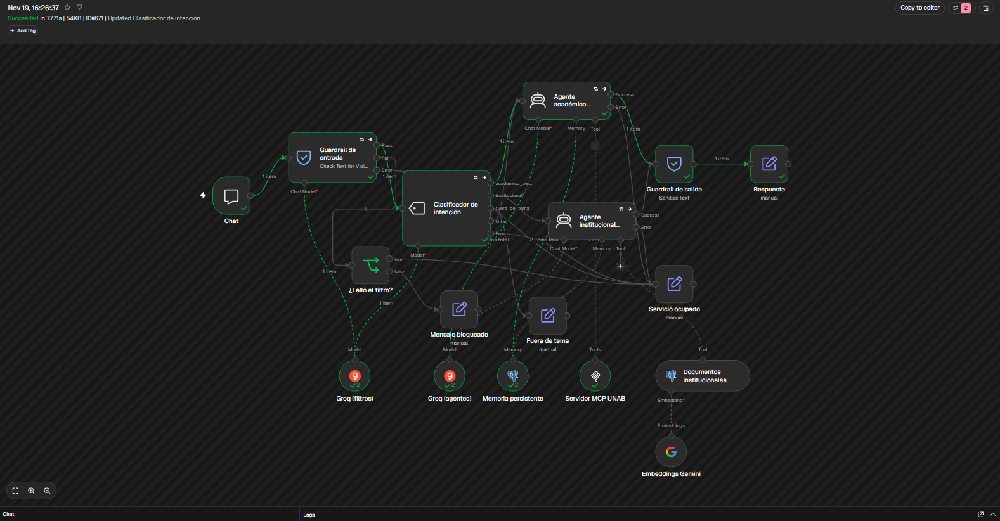<br>
  <em>n8n · ejecución exitosa (<em>Succeeded</em>) por la ruta del agente académico: guardrail de entrada, clasificador, agente con el servidor MCP,
  guardrail de salida y respuesta.</em>
</p>

<p align="center">
  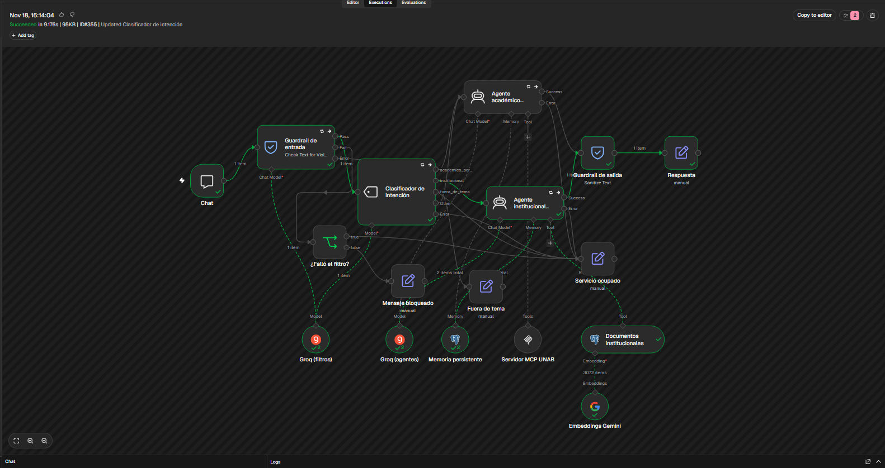<br>
  <em>n8n · ejecución exitosa por la ruta del agente institucional: búsqueda en los documentos con los embeddings de Gemini (3072 dimensiones).</em>
</p>

<p align="center">
  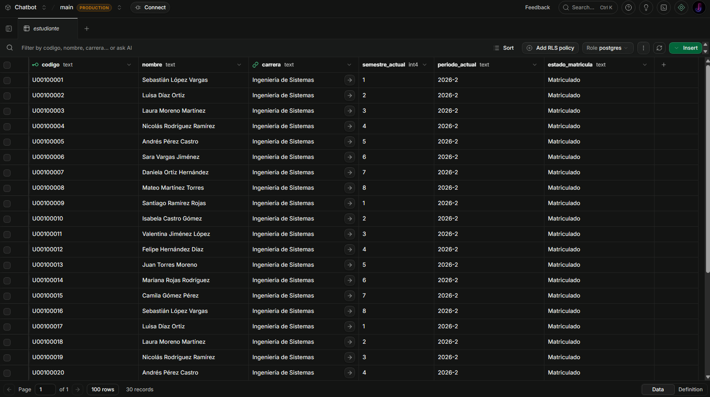<br>
  <em>Supabase · tabla <code>estudiante</code> con los 30 estudiantes sintéticos.</em>
</p>

<p align="center">
  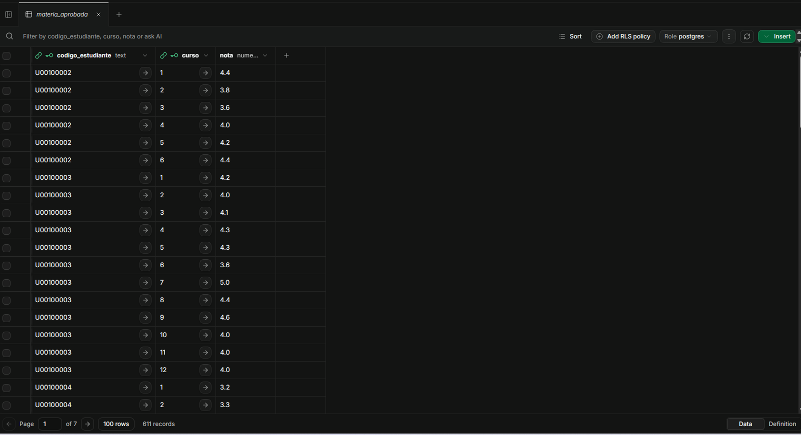<br>
  <em>Supabase · tabla <code>materia_aprobada</code> con las notas (611 al tomar la captura; 616 tras añadir los prerrequisitos).</em>
</p>

## Cómo funciona la identidad

No hay cuentas. La primera respuesta del asistente es pedir el código estudiantil. [`sitio-web/public/js/chat.js`](sitio-web/public/js/chat.js) lo detecta en
lo que escribe el estudiante (`U` + 8 dígitos) y lo envía con cada pregunta (`metadata.codigo`); el agente lo valida con `consultar_estudiante` y usa ese
código en las demás herramientas. El botón *Nuevo chat* (o recargar la página) abre otra sesión con memoria nueva. **El código es lo único que identifica al
estudiante**: por eso los datos son sintéticos. Con datos reales habría que validar contra Banner o contra el inicio de sesión institucional (Microsoft 365).

## Seguridad

| Capa | Medida |
|---|---|
| Red | La web y el MCP escuchan solo en `127.0.0.1`; el túnel de Cloudflare los publica con HTTPS. Sin puertos abiertos en Azure. |
| MCP | Toda petición exige `Authorization: Bearer <MCP_TOKEN>` (comparación en tiempo constante); sin token válido el servicio no arranca. |
| Web | CSP estricta con *nonce* y sin scripts en línea, `X-Frame-Options: DENY`, `nosniff`, `Referrer-Policy`, `Permissions-Policy`, COOP y CORP, HSTS y redirección 301 de HTTP a HTTPS; sin `X-Powered-By`. Validación en servidor y límite por IP (10 por minuto y 300 por día). |
| n8n | El webhook del chat exige usuario y clave. *Guardrails* de entrada (jailbreak, claves secretas) y de salida (tarjetas, IBAN, cripto, claves). |
| Supabase | RLS activo y sin políticas en todas las tablas, acceso revocado a `anon` y `authenticated`, vistas con `security_invoker`. Solo entran n8n y el MCP, por conexión directa a Postgres. |
| Secretos | `.env` fuera de git; en la VM viven en `/etc/unab` (modo 700, solo root) y cada servicio recibe solo sus variables; las claves de n8n quedan cifradas en n8n Cloud. |
| Dependencias | `composer audit` en cada despliegue; `pip-audit -r servidor-mcp/requirements.txt` para el MCP. |

## Decisiones de diseño y límites

- **El código estudiantil es la única credencial.** Es el diseño acordado (sin registro ni inicio de sesión) y por eso los datos son sintéticos: quien
  conozca un código ve los datos de ese estudiante. Con datos reales habría que validar contra el sistema académico o el inicio de sesión institucional.
- **Modelos.** Los agentes usan `gpt-oss-20b` y los filtros `gpt-oss-120b`. Se probó `qwen3.8-27b` para los agentes y se descartó: a partir del segundo
  mensaje respondía sin llamar a las herramientas e inventaba datos.
- **Plan gratuito de Groq.** Cada modelo permite 8 000 tokens por minuto y 200 000 por día. Una pregunta gasta unos 3 000 a 6 000 tokens, así que alcanza
  para unas decenas de preguntas al día; para demos largas conviene el plan de pago. Los prompts y las descripciones de herramientas son cortos a propósito.
- **Respuesta con efecto de escritura, no streaming real.** El streaming nativo de n8n impide que el *guardrail* de salida revise el texto antes de
  que lo vea el estudiante y deja sin respuesta las rutas sin agente (fuera de tema, mensaje bloqueado, servicio ocupado). Además, con Groq el texto llegó de golpe en la prueba (123 fragmentos en 10 ms), así que no mejoraba la espera. La web muestra la respuesta, ya revisada, palabra por palabra.
- **Latencia.** Una pregunta tarda de 8 a 12 segundos: dos llamadas al modelo, la consulta a las herramientas y la memoria. El MCP usa un pool de
  conexiones a Supabase para no abrir una conexión por consulta.
- **Alcance de los datos.** Los prerrequisitos son de demostración (coherentes con el plan, no los oficiales), no hay materias reprobadas ni notas del semestre en curso (por eso nadie queda en prueba
  académica en la demo) y las notas, el calendario y los documentos son ficticios.
- **Docker.** `docker-compose.yml` y `servidor-mcp/Dockerfile` son una alternativa al instalador para correr el MCP; no se han ejecutado en este entorno.

## Hoja de ruta

- Segundo factor de identificación (por ejemplo un PIN) o inicio de sesión institucional.
- Conexión a datos reales (prerrequisitos oficiales y notas reales requieren un export o acceso a Banner), calendario oficial y documentos oficiales del programa.
  Para reemplazar los documentos de demostración: `truncate n8n_vectors` y subir los oficiales por el formulario de ingesta.
- Registro de conversaciones y valoración de respuestas para medir calidad.
- Alerta automática si la web o el MCP dejan de responder.
- Plan de pago de Groq para quitar el límite de tokens.

## Créditos

Proyecto académico de la asignatura Ciencia de Datos, Ingeniería de Sistemas (UNAB).
Tecnologías de terceros: [n8n](https://n8n.io), [Groq](https://groq.com) con los modelos `gpt-oss`, [FastMCP](https://gofastmcp.com),
[Supabase](https://supabase.com), [Laravel](https://laravel.com), [Cloudflare](https://www.cloudflare.com) y Gemini para los embeddings.
