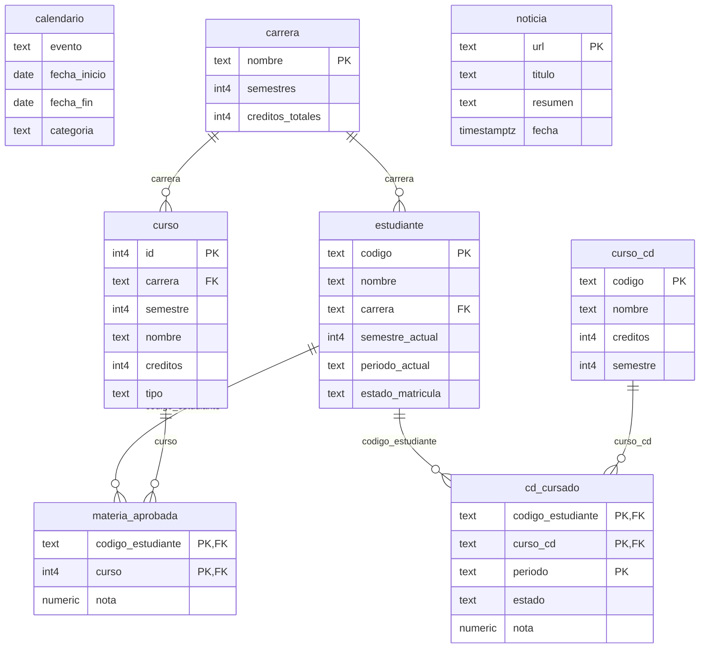

# Evidencias del funcionamiento

Generado el 2026-11-18 16:13 (hora de Colombia) con `python pruebas/generar_evidencias.py`. Todo lo que aparece aquí es la salida real de llamadas al sistema en producción; los datos de estudiantes son sintéticos y las claves se muestran como variables (`$MCP_TOKEN`, `$N8N_CHAT_USER`, …).

[1. Servidor MCP](#1-servidor-mcp-probado-con-curl) · [2. Webhook de n8n](#2-webhook-de-n8n-probado-con-curl) · [3. Base de datos](#3-base-de-datos-postgresql-supabase) · [4. Ejecuciones en n8n](#4-ejecuciones-en-n8n-cloud) · [5. Recuperación del RAG](#5-recuperación-del-rag)

## 1. Servidor MCP probado con curl

El servidor es público en `https://mcp.javier.life/mcp` a través del túnel de Cloudflare y exige un token Bearer.

**Sin token** (debe rechazar):
```bash
curl -s -o /dev/null -w "%{http_code}" -X POST https://mcp.javier.life/mcp
401
```

**Inicio de sesión MCP y lista de herramientas:**
```bash
curl -X POST https://mcp.javier.life/mcp \
  -H "Authorization: Bearer $MCP_TOKEN" \
  -H "Content-Type: application/json" -H "Accept: application/json, text/event-stream" \
  -d '{"jsonrpc": "2.0", "id": 1, "method": "initialize", "params": {"protocolVersion": "2025-03-26", "capabilities": {}, "clientInfo": {"name": "evidencias", "version": "1"}}}'
```
```json
{
  "serverInfo": {
    "name": "Asistente académico",
    "version": "4.1.6"
  },
  "protocolVersion": "2025-03-26",
  "capabilities": [
    "logging",
    "prompts",
    "resources",
    "tools"
  ]
… (1 líneas más)
```
El servidor devuelve la cabecera `mcp-session-id`, que se envía en las llamadas siguientes como `$SESION`.

```bash
curl -X POST https://mcp.javier.life/mcp \
  -H "Authorization: Bearer $MCP_TOKEN" \
  -H "Content-Type: application/json" -H "Accept: application/json, text/event-stream" \
  -H "mcp-session-id: $SESION" \
  -d '{"jsonrpc": "2.0", "id": 1, "method": "tools/list", "params": {}}'
```

Respuesta: **9 herramientas**.

| Herramienta | Descripción (del propio servidor) |
|---|---|
| `consultar_estudiante` | Identifica al estudiante por su código: nombre, carrera, semestre y estado de matrícula. |
| `avance_y_proyeccion` | Créditos aprobados y pendientes, porcentaje de avance y semestres restantes estimados (por defecto con la carga típica de la carrera). |
| `cursos_recomendados` | Materias pendientes sugeridas para el próximo periodo (semestres bajos primero, sin pasar de max_creditos; por defecto la carga típica). |
| `competencias_digitales` | Estado de los cursos CD01 a CD04 de la insignia (aprobado con nota, en curso, reprobado, pendiente) y si ya la obtuvo. |
| `plan_de_estudios` | Materias y créditos del plan, opcionalmente de un semestre (1 a 8). |
| `calendario_academico` | Fechas del calendario académico (inscripciones, cortes, exámenes, festivos, grados). |
| `noticias_recientes` | Últimas noticias y convocatorias de la universidad. |
| `promedio_y_estado` | Promedio acumulado (ponderado por créditos) y situación según el reglamento: prueba académica, carga máxima de créditos y becas. |
| `calcular_nota` | Nota de UNA materia (0.0 a 5.0, se aprueba con 3.0; cortes 30 %, 30 % y examen final 40 %). |

**Consulta a la base: datos del estudiante U00100005:**
```bash
curl -X POST https://mcp.javier.life/mcp \
  -H "Authorization: Bearer $MCP_TOKEN" \
  -H "Content-Type: application/json" -H "Accept: application/json, text/event-stream" \
  -H "mcp-session-id: $SESION" \
  -d '{"jsonrpc": "2.0", "id": 1, "method": "tools/call", "params": {"name": "consultar_estudiante", "arguments": {"codigo": "U00100005"}}}'
```
```json
{
  "codigo": "U00100005",
  "nombre": "Andrés Pérez Castro",
  "carrera": "Ingeniería de Sistemas",
  "semestre_actual": 5,
  "periodo_actual": "2026-2",
  "estado_matricula": "Matriculado",
  "aviso": "Datos de demostración (base sintética), no del sistema académico oficial."
}
```

**Promedio y situación académica según el reglamento:**
```bash
curl -X POST https://mcp.javier.life/mcp \
  -H "Authorization: Bearer $MCP_TOKEN" \
  -H "Content-Type: application/json" -H "Accept: application/json, text/event-stream" \
  -H "mcp-session-id: $SESION" \
  -d '{"jsonrpc": "2.0", "id": 1, "method": "tools/call", "params": {"name": "promedio_y_estado", "arguments": {"codigo": "U00100005"}}}'
```
```json
{
  "promedio_acumulado": 3.74,
  "materias_con_nota": 22,
  "creditos_con_nota": 61,
  "estado": "buen estado académico",
  "puede_inscribir_hasta_creditos": 18,
  "cumple_promedio_beca_investigacion": false,
  "puesto_en_el_programa": "20 de 26",
  "dentro_del_5_por_ciento_mejor_promedio": false,
  "aviso": "Solo cuenta materias aprobadas (la base no guarda reprobadas). Datos de demostración."
}
```

**Calculadora de notas (3.2 y 2.8 en los dos primeros cortes):**
```bash
curl -X POST https://mcp.javier.life/mcp \
  -H "Authorization: Bearer $MCP_TOKEN" \
  -H "Content-Type: application/json" -H "Accept: application/json, text/event-stream" \
  -H "mcp-session-id: $SESION" \
  -d '{"jsonrpc": "2.0", "id": 1, "method": "tools/call", "params": {"name": "calcular_nota", "arguments": {"primer_corte": 3.2, "segundo_corte": 2.8}}}'
```
```json
{
  "pesos": "primer corte 30 %, segundo corte 30 %, examen final 40 %",
  "nota_minima_para_aprobar": 3.0,
  "puntos_acumulados": 1.8,
  "falta": [
    "examen final"
  ],
  "peso_de_lo_que_falta": "40 %",
  "puede_aprobar": true,
  "nota_necesaria": 3.0,
  "mensaje": "Es la nota mínima (con un decimal) que necesita en examen final para llegar a 3.0."
}
```

**Calendario: búsqueda de «inscripción»:**
```bash
curl -X POST https://mcp.javier.life/mcp \
  -H "Authorization: Bearer $MCP_TOKEN" \
  -H "Content-Type: application/json" -H "Accept: application/json, text/event-stream" \
  -H "mcp-session-id: $SESION" \
  -d '{"jsonrpc": "2.0", "id": 1, "method": "tools/call", "params": {"name": "calendario_academico", "arguments": {"buscar": "inscripción"}}}'
```
```json
{
  "result": [
    {
      "evento": "Inscripción de materias 2027-1 (incluye cursos CD de la insignia)",
      "fecha_inicio": "2026-12-07",
      "fecha_fin": "2026-12-18",
      "categoria": "matricula"
    }
  ]
}
```

## 2. Webhook de n8n probado con curl

Es el mismo webhook que usa la web. Exige usuario y clave (Basic Auth). Las preguntas pasan por los guardrails, el clasificador y el agente.

**Sin credenciales** (debe rechazar):
```bash
curl -s -o /dev/null -w "%{http_code}" -X POST "$N8N_CHAT_URL" -H "Content-Type: application/json" -d '{}'
401
```

```bash
curl -X POST "$N8N_CHAT_URL" -u "$N8N_CHAT_USER:$N8N_CHAT_PASSWORD" \
  -H "Content-Type: application/json" \
  -d '{"action": "sendMessage", "sessionId": "chat-<id-de-la-conversación>", "chatInput": "U00100005", "metadata": {"codigo": "U00100005"}}'
```
```json
{
  "output": "Andrés, semestre 5, matriculado. ¿En qué te puedo ayudar?"
}
```

```bash
curl -X POST "$N8N_CHAT_URL" -u "$N8N_CHAT_USER:$N8N_CHAT_PASSWORD" \
  -H "Content-Type: application/json" \
  -d '{"action": "sendMessage", "sessionId": "chat-<id-de-la-conversación>", "chatInput": "¿Cuál es mi promedio y cuántos créditos puedo inscribir?", "metadata": {"codigo": "U00100005"}}'
```
```json
{
  "output": "Tu promedio acumulado es 3.74. Puedes inscribir hasta 18 créditos en el próximo periodo. El siguiente paso es revisar el plan de estudios para elegir las materias que te permitan avanzar sin superar la carga máxima."
}
```

## 3. Base de datos PostgreSQL (Supabase)

Conexión directa al servidor de Supabase (*Session pooler*): **PostgreSQL 17.11**, extensión `vector` 0.8.2.

**Tablas, filas y seguridad a nivel de fila (RLS):**

| Tabla | Filas | RLS |
|---|---|---|
| `calendario` | 30 | sí |
| `carrera` | 1 | sí |
| `cd_cursado` | 96 | sí |
| `curso` | 47 | sí |
| `curso_cd` | 4 | sí |
| `estudiante` | 30 | sí |
| `materia_aprobada` | 611 | sí |
| `n8n_chat_histories` | 440 | sí |
| `n8n_vectors` | 23 | sí |
| `noticia` | 27 | sí |

Vistas: `v_aprobados`, `v_avance`, `v_cd_estado`, `v_pendientes`.

**Modelo entidad-relación** (generado a partir del catálogo de la base, no dibujado a mano):



Las tablas `n8n_chat_histories` (memoria del chat) y `n8n_vectors` (vectores del RAG) las usa n8n y no se relacionan con las académicas.

**Filas de ejemplo** (datos sintéticos):

*Estudiantes:*

| Código | Nombre | Semestre | Periodo | Matrícula |
|---|---|---|---|---|
| U00100001 | Sebastián López Vargas | 1 | 2026-2 | Matriculado |
| U00100002 | Luisa Díaz Ortiz | 2 | 2026-2 | Matriculado |
| U00100003 | Laura Moreno Martínez | 3 | 2026-2 | Matriculado |
| U00100004 | Nicolás Rodríguez Ramírez | 4 | 2026-2 | Matriculado |

*Avance (vista `v_avance`):*

| Código | Créditos aprobados | Pendientes | % avance |
|---|---|---|---|
| U00100005 | 61 | 73 | 45.5 |
| U00100018 | 16 | 118 | 11.9 |

*Materias aprobadas con nota:*

| Código | Materia | Créditos | Nota |
|---|---|---|---|
| U00100005 | ELECTIVA EHLE (ESCUCHA, HABLA Y LECTURA) | 4 | 3.9 |
| U00100005 | PENSAMIENTO SISTEMICO | 2 | 4.2 |
| U00100005 | RAZONAMIENTO ALGORITMICO | 3 | 3.9 |
| U00100005 | TECNOLOGÍAS PARA EL ENTORNO DE DESARROLLO | 2 | 3.1 |

*Cursos de la insignia (vista `v_cd_estado`):*

| Código | Curso | Nombre | Estado | Nota |
|---|---|---|---|---|
| U00100005 | CD01 | Alfabetización Digital | reprobado: debe repetirlo |  |
| U00100005 | CD02 | Herramientas Digitales para la Productividad | aprobado | 3.3 |
| U00100005 | CD03 | Ciudadanía Digital y Seguridad de la Información | reprobado: debe repetirlo |  |
| U00100005 | CD04 | Inteligencia Artificial Generativa para el Aprendizaje | aprobado | 4.3 |

*Calendario:*

| Evento | Inicio | Fin | Categoría |
|---|---|---|---|
| Adición y retiro de materias sin costo 2026-2 | 2026-08-03 | 2026-08-14 | matricula |
| Inicio de clases 2026-2 | 2026-08-03 |  | academico |
| Fecha límite para pedir aplazamiento del semestre 2026-2 | 2026-08-21 |  | matricula |
| Primer corte de notas 2026-2 (30 %) | 2026-09-07 | 2026-09-11 | evaluaciones |

*Noticias (las escribe el scraper):*

| Fecha | Título | Fuente |
|---|---|---|
| 2026-11-18 | Abiertos los cursos vacacionales intensivos de Competencias Digitales | https://unab.edu.co/cursos-vacacionales-de-competencias-digitales-unab/ |
| 2026-11-18 | Experto temático para el curso «Negocios Digitales Transformativos» para el Cent | https://unab.edu.co/experto-tematico-para-el-curso-negocios-digitales-transforma |
| 2026-11-17 | Conoce tu campus: un recorrido por los espacios que hacen parte de nuestra histo | https://unab.edu.co/conoce-tu-campus-un-recorrido-por-los-espacios-que-hacen-par |
| 2026-11-17 | Así se porta la dotación institucional 2026 | https://unab.edu.co/asi-se-porta-la-dotacion-institucional-2026/ |

*Fragmentos del RAG por documento:*

| Documento | Fragmentos | Dimensiones |
|---|---|---|
| bienestar becas y apoyos | 3 | 3072 |
| homologaciones reintegros y traslados | 3 | 3072 |
| insignia competencias digitales | 2 | 3072 |
| opciones de grado y practica profesional | 3 | 3072 |
| plan de estudios ingenieria de sistemas | 4 | 3072 |
| proceso inscripcion y matricula | 4 | 3072 |
| reglamento estudiantil resumen | 4 | 3072 |

## 4. Ejecuciones en n8n Cloud

Datos leídos del registro de ejecuciones de n8n Cloud.

**Chatbot UNAB**, últimas ejecuciones:

| Ejecución | Inicio (hora Colombia) | Modo | Estado |
|---|---|---|---|
| 357 | 2026-11-18 16:14 | webhook | ✔ éxito |
| 356 | 2026-11-18 16:14 | webhook | ✔ éxito |
| 355 | 2026-11-18 16:14 | webhook | ✔ éxito |
| 354 | 2026-11-18 16:13 | webhook | ✔ éxito |
| 353 | 2026-11-18 16:13 | webhook | ✔ éxito |
| 352 | 2026-11-18 16:11 | webhook | ✔ éxito |

**Noticias UNAB**, últimas ejecuciones:

| Ejecución | Inicio (hora Colombia) | Modo | Estado |
|---|---|---|---|
| 348 | 2026-11-18 12:00 | automático (cada 6 h) | ✔ éxito |
| 345 | 2026-11-18 06:00 | automático (cada 6 h) | ✔ éxito |
| 344 | 2026-11-18 00:00 | automático (cada 6 h) | ✔ éxito |
| 343 | 2026-11-17 18:00 | automático (cada 6 h) | ✔ éxito |
| 313 | 2026-11-17 12:00 | automático (cada 6 h) | ✔ éxito |
| 219 | 2026-11-17 06:00 | automático (cada 6 h) | ✔ éxito |

**Ingesta de documentos**, últimas ejecuciones:

| Ejecución | Inicio (hora Colombia) | Modo | Estado |
|---|---|---|---|
| 65 | 2026-11-14 17:14 | webhook | ✔ éxito |
| 64 | 2026-11-14 17:13 | webhook | ✔ éxito |
| 51 | 2026-11-14 16:52 | webhook | ✔ éxito |
| 46 | 2026-11-14 16:47 | webhook | ✔ éxito |

**Recorrido de una ejecución exitosa del chatbot** (ejecución 354): pregunta *«¿Cuál es mi promedio y cuántos créditos puedo inscribir?»*.

| # | Nodo | Estado | Tiempo (ms) |
|---|---|---|---|
| 1 | Chat | ✔ | 1 |
| 2 | Guardrail de entrada | ✔ | 671 |
| 3 | Groq (filtros) | ✔ | 658 |
| 4 | Clasificador de intención | ✔ | 410 |
| 5 | Groq (filtros) | ✔ | 399 |
| 6 | Agente académico (MCP) | ✔ | 5837 |
| 7 | Memoria persistente | ✔ | 333 |
| 8 | Groq (agentes) | ✔ | 436 |
| 9 | Servidor MCP UNAB | ✔ | 1341 |
| 10 | Groq (agentes) | ✔ | 409 |
| 11 | Memoria persistente | ✔ | 501 |
| 12 | Guardrail de salida | ✔ | 3 |
| 13 | Respuesta | ✔ | 1 |

Herramientas del MCP que llamó el agente:

- `promedio_y_estado` con `{"codigo": "U00100005", "con_detalle": false}`

Respuesta final que recibió el estudiante:

> Tu promedio acumulado es 3.74. Puedes inscribir hasta 18 créditos en el próximo periodo. El siguiente paso es revisar el plan de estudios para elegir las materias que te permitan avanzar sin superar la carga máxima.

## 5. Recuperación del RAG

Preguntas reales que el clasificador envió al agente institucional. Se ve la búsqueda que formuló el agente y los fragmentos que devolvió pgvector (los 5 más parecidos, `topK = 5`), cada uno con el documento del que sale.

### Pregunta: «¿Qué requisitos necesito para inscribir la práctica profesional?» (ejecución 357)

Búsqueda del agente: `{"input": "requisitos inscripción práctica profesional"}`

| # | Documento | Inicio del fragmento |
|---|---|---|
| 1 | opciones de grado y practica profesional | Práctica profesional - Se cursa en octavo semestre y vale 12 créditos. - Para in |
| 2 | opciones de grado y practica profesional | Requisitos de grado y práctica profesional (documento de demostración)  Contenid |
| 3 | plan de estudios ingenieria de sistemas | Cursos Menor Entre quinto y octavo semestre el estudiante cursa cuatro «Cursos M |
| 4 | opciones de grado y practica profesional | Práctica en emprendimiento Un estudiante con un proyecto de empresa propio puede |
| 5 | plan de estudios ingenieria de sistemas | Prerrequisitos El plan cargado en el sistema no incluye prerrequisitos. Se recom |

Respuesta:

> Para inscribir la práctica profesional, según el documento *opciones de grado y práctica profesional*, debes haber aprobado al menos 110 créditos del plan, contar con un promedio acumulado de 3.0 o más y tener la insignia de competencias digitales en curso o terminada. Además, el documento *plan de estudios ingeniería de sistemas* indica que la práctica se cursa en octavo semestre como componente de 12 créditos.  
> 
> Si necesitas confirmar algún detalle adicional, te sugiero contactar a la dirección del programa.

### Pregunta: «¿Cuántos créditos puedo homologar de otra universidad?» (ejecución 356)

Búsqueda del agente: `{"input": "homologar créditos otra universidad"}`

| # | Documento | Inicio del fragmento |
|---|---|---|
| 1 | homologaciones reintegros y traslados | Homologaciones, reintegros y traslados (documento de demostración)  Contenido fi |
| 2 | homologaciones reintegros y traslados | Intercambios y movilidad - Se pueden cursar uno o dos semestres en una universid |
| 3 | homologaciones reintegros y traslados | Reintegro - Un estudiante que se retiró del programa o aplazó más de dos semestr |
| 4 | reglamento estudiantil resumen | Repetición de materias - Una materia reprobada debe repetirse la próxima vez que |
| 5 | proceso inscripcion y matricula | Adición y cancelación de materias - Durante las dos primeras semanas de clase se |

Respuesta:

> Según el documento *homologaciones reintegros y traslados*, la homologación no puede superar el 40 % de los créditos del plan, es decir, hasta 53 de los 134 créditos de Ingeniería de Sistemas.  
> 
> Para solicitar la homologación, debes presentar el certificado de notas original y los contenidos programáticos sellados por la institución de origen en el primer semestre de ingreso. La dirección del programa te responderá en un máximo de quince días hábiles.  
> 
> Si necesitas más información o tienes dudas específicas, contacta a la dirección del programa.

### Pregunta: «¿Cuál es la nota mínima para aprobar una materia y qué pasa si falto a clases?» (ejecución 355)

Búsqueda del agente: `{"input": "nota mínima aprobar materia falta a clases"}`

| # | Documento | Inicio del fragmento |
|---|---|---|
| 1 | reglamento estudiantil resumen | Asistencia - La asistencia mínima es del 80 % de las sesiones de cada materia. C |
| 2 | reglamento estudiantil resumen | Repetición de materias - Una materia reprobada debe repetirse la próxima vez que |
| 3 | reglamento estudiantil resumen | Faltas disciplinarias - El fraude académico (copia, suplantación, plagio) se san |
| 4 | reglamento estudiantil resumen | Reglamento estudiantil de pregrado: resumen (documento de demostración)  Conteni |
| 5 | proceso inscripcion y matricula | Adición y cancelación de materias - Durante las dos primeras semanas de clase se |

Respuesta:

> La nota mínima para aprobar una materia es 3.0, según el documento *reglamento estudiantil resumen*.  
> En cuanto a la asistencia, la misma debe ser al menos del 80 % de las sesiones; si la asistencia cae por debajo de ese umbral, la materia se pierde por inasistencia, sin importar la nota obtenida, también según el *reglamento estudiantil resumen*.
> 
> Si necesitas más detalles o tienes dudas específicas sobre tu caso, te recomiendo contactar a la dirección del programa.

