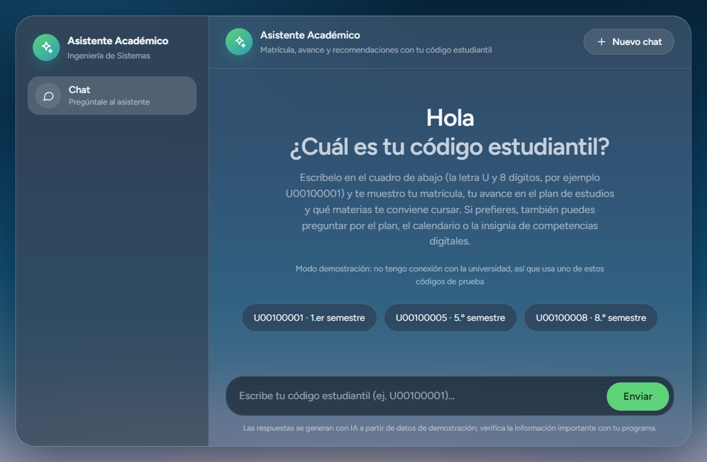
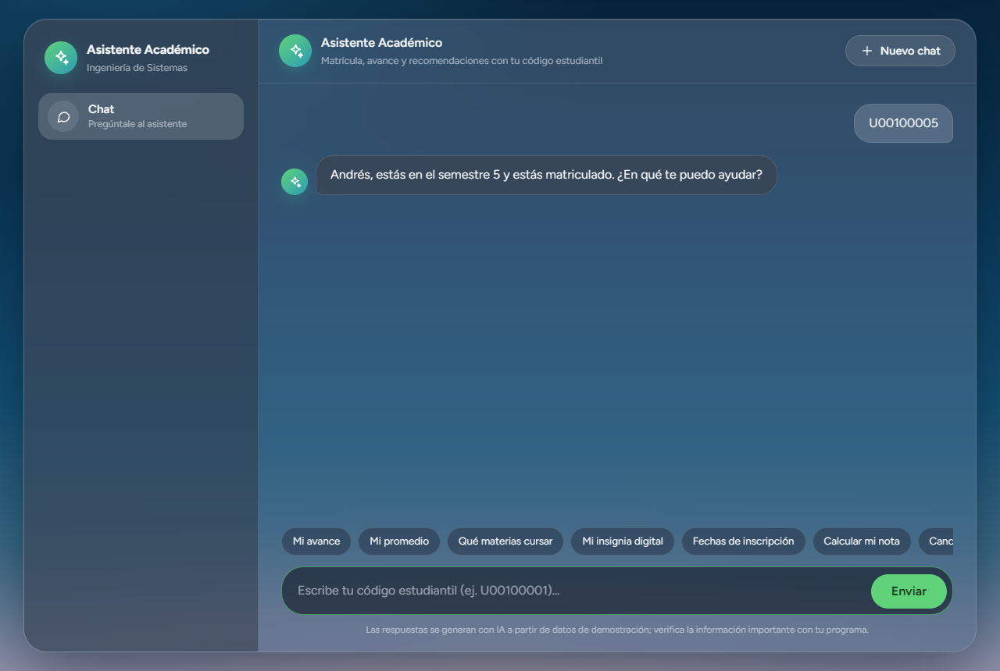

# Manual de usuario · Asistente Académico de Ingeniería de Sistemas

Guía para estudiantes. Explica cómo entrar, cómo identificarte, qué puedes preguntar y qué hacer si algo no funciona.

> **Versión de demostración.** El asistente no está conectado a los sistemas de la universidad: los estudiantes, notas, calendario y documentos
> son ficticios. Usa los códigos de prueba de la sección 2.

## Contenido

1. [Qué es el asistente](#1-qué-es-el-asistente) · 2. [Cómo empezar](#2-cómo-empezar) · 3. [Qué puedes preguntar](#3-qué-puedes-preguntar) ·
4. [Preguntas sugeridas y nuevo chat](#4-preguntas-sugeridas-y-nuevo-chat) · 5. [Cómo leer las respuestas](#5-cómo-leer-las-respuestas) ·
6. [Mensajes del sistema](#6-mensajes-del-sistema-y-qué-hacer) · 7. [Privacidad](#7-privacidad-y-buen-uso) · 8. [Preguntas frecuentes](#8-preguntas-frecuentes)

## 1. Qué es el asistente

Un chat que responde con **tu información académica** (matrícula, avance, promedio, materias que te conviene cursar, cursos de la insignia de
competencias digitales) y con **información del programa** (reglamento, inscripciones, becas, requisitos de grado, calendario y noticias).
Las respuestas sobre normas citan el documento del que salen.

## 2. Cómo empezar

1. Abre <https://chatbot.javier.life> en el navegador del computador o del celular. No necesitas cuenta ni contraseña.
   También puedes usar la **app móvil**: instala *Expo Go* en tu teléfono y escanea el código QR que te comparta el equipo del proyecto. La app muestra el mismo chat, así que todo lo de este manual vale igual.
2. Escribe tu **código estudiantil**: la letra `U` seguida de 8 dígitos (por ejemplo `U00100005`) y pulsa **Enviar**.
   También puedes pulsar uno de los códigos de prueba que aparecen en la pantalla de bienvenida.
3. El asistente te saluda con tu nombre, tu semestre y tu estado de matrícula. Desde ese momento ya puedes preguntar.

   
  <em>Pantalla de bienvenida con los códigos de prueba.</em>

   
  <em>Después de escribir el código: saludo personalizado y barra de preguntas sugeridas.</em>

**Códigos de prueba útiles:**

| Código | Qué verás |
|---|---|
| `U00100005` | Estudiante de 5.º semestre con 48.5 % de avance, promedio 3.73 y algunas materias bloqueadas por prerrequisitos. |
| `U00100018` | El mejor promedio del programa (4.68): puede inscribir hasta 21 créditos. |
| `U00100004` | El promedio más bajo (3.38). |
| `U00100001` | Primer semestre: todavía no tiene materias con nota. |

Si el código no existe, el asistente te pedirá que lo revises. Si escribes otro código en la misma conversación, el asistente cambia de estudiante.

**Escribir y enviar:** con teclado físico, `Enter` envía y `Mayús + Enter` hace un salto de línea. En el celular, `Enter` hace salto de línea y se envía
con el botón **Enviar**. Cada mensaje debe tener entre 2 y 1000 caracteres.

## 3. Qué puedes preguntar

| Tema | Ejemplos de preguntas |
|---|---|
| Matrícula | «¿Cuál es mi estado de matrícula?» |
| Avance y proyección | «¿Cuánto me falta para graduarme?», «¿Qué porcentaje de la carrera llevo?», «Si tomo 15 créditos por semestre, ¿cuándo termino?» |
| Materias recomendadas | «¿Qué materias debería cursar el próximo semestre?», «Recomiéndame materias sin pasar de 12 créditos» |
| Promedio y situación | «¿Cuál es mi promedio?», «¿Estoy en prueba académica?», «¿Cuántos créditos puedo inscribir?», «¿Califico para una beca?» |
| Notas por materia | «¿Qué nota saqué en Álgebra Lineal?» (solo materias aprobadas) |
| Calculadora de notas | «Saqué 3.2 en el primer corte y 2.8 en el segundo, ¿qué necesito en el final?» |
| Insignia de competencias digitales | «¿Qué cursos de competencias digitales he tomado?», «¿Qué es la insignia?» |
| Plan de estudios | «¿Qué materias tiene el cuarto semestre?», «¿Qué necesito para ver Ciberseguridad?» |
| Calendario | «¿Cuándo es la inscripción de materias?», «¿Hasta cuándo puedo cancelar una materia?» |
| Normas y trámites | «¿Qué pasa si falto a más del 20 % de las clases?», «¿Cuántos créditos puedo homologar?», «¿Qué necesito para la práctica profesional?» |
| Noticias | «¿Qué noticias hay de la universidad?», «¿Qué noticias de tecnología hay?» (cada noticia trae su fecha y su enlace) |

**Sobre la calculadora de notas:** los pesos son 30 % (primer corte), 30 % (segundo corte) y 40 % (examen final), y se aprueba con 3.0. Dale las
notas que ya tienes; si te falta una, te dice qué necesitas en ella. Si ya tienes las tres, te da la nota definitiva.

**Fuera de alcance:** el asistente solo atiende temas académicos de Ingeniería de Sistemas. No tiene datos de pagos ni de notas de materias
reprobadas o en curso. Entiende preguntas en inglés, pero siempre responde en español.

## 4. Preguntas sugeridas y nuevo chat

- Cuando te identificas aparece, sobre el cuadro de texto, una **barra de preguntas sugeridas** (Mi avance, Mi promedio, Qué materias cursar,
  Mi insignia digital, Fechas de inscripción, Calcular mi nota, Cancelar una materia, Requisitos de grado, Becas, Noticias). Al pulsar una, se envía
  como si la hubieras escrito, y desaparece de la barra.
- El botón **Nuevo chat** (arriba a la derecha) empieza una conversación nueva: el asistente olvida la anterior y tendrás que dar tu código otra vez.
  Recargar la página hace lo mismo.
- Dentro de una conversación, el asistente recuerda los últimos intercambios. Si cambias de tema después de muchas preguntas, da el contexto completo.

## 5. Cómo leer las respuestas

- **Datos tuyos:** salen de la base de datos en el momento de la pregunta (no de memoria del modelo).
- **Normas y trámites:** la respuesta dice de qué documento sale, por ejemplo «según el documento reglamento estudiantil resumen».
- **Siguiente paso:** muchas respuestas terminan con una acción concreta (revisar el calendario, hablar con la dirección del programa…).
- **Prerrequisitos:** el asistente solo te recomienda materias cuyos prerrequisitos ya aprobaste y, si preguntas por una bloqueada, te dice qué te falta. En esta versión son de demostración: confirma los oficiales con tu programa.
- Las respuestas tardan entre 8 y 12 segundos. Mientras tanto verás «Buscando la información…» y luego el texto aparece palabra por palabra.

## 6. Mensajes del sistema y qué hacer

| Mensaje | Qué significa | Qué hacer |
|---|---|---|
| «El asistente alcanzó su límite temporal de uso…» | El servicio de inteligencia artificial gratuito llegó a su cupo. | Espera un minuto y vuelve a preguntar. Si persiste, inténtalo más tarde. |
| «Hiciste muchas preguntas seguidas…» | Superaste 10 preguntas por minuto (o 300 por día) desde tu conexión. | Espera un minuto. |
| «No puedo procesar ese mensaje. Reformula tu pregunta…» | El filtro de seguridad bloqueó el mensaje (por ejemplo, intentos de cambiar las instrucciones del asistente o una clave pegada). | Reescribe la pregunta sobre un tema académico. |
| «Puedo ayudarte únicamente con temas académicos…» | La pregunta no tiene relación con lo académico. | Pregunta sobre tu carrera, tus datos o las normas. |
| «El asistente no está disponible en este momento…» / «No pude conectarme con el asistente» | Fallo pasajero de conexión. | Intenta de nuevo en un minuto; si sigue, pulsa **Nuevo chat**. |
| «Escribe una pregunta de al menos 2 caracteres.» | El mensaje está vacío o es demasiado corto. | Escribe una pregunta completa. |

## 7. Privacidad y buen uso

- **Tu código es lo único que te identifica.** No lo compartas: quien lo conozca podría consultar tus datos. (En esta versión de demostración los
  datos son ficticios.)
- No escribas contraseñas, claves ni datos bancarios en el chat. El asistente los filtra, pero no los necesita para nada.
- La información es orientativa. Para decisiones importantes (inscripciones, grado, becas) confírmala con la dirección del programa.

## 8. Preguntas frecuentes

**¿Necesito registrarme?** No. Solo escribes tu código estudiantil.

**¿Puedo usarlo en el celular?** Sí: desde el navegador, porque la página se adapta a pantallas pequeñas, o con la app móvil en Expo Go. En la app, el botón *Atrás* del teléfono navega dentro del chat y los enlaces externos se abren en el navegador.

**¿Por qué me dice que no tiene mi nota de una materia?** Solo hay notas de materias aprobadas; las reprobadas y las del semestre en curso no están.

**¿Por qué la respuesta dice que los datos son de demostración?** Porque el asistente no está conectado a los sistemas reales de la universidad.

**¿Se guardan mis conversaciones?** Se guarda el historial de cada chat para que el asistente recuerde el contexto; al pulsar **Nuevo chat** empieza uno nuevo.
